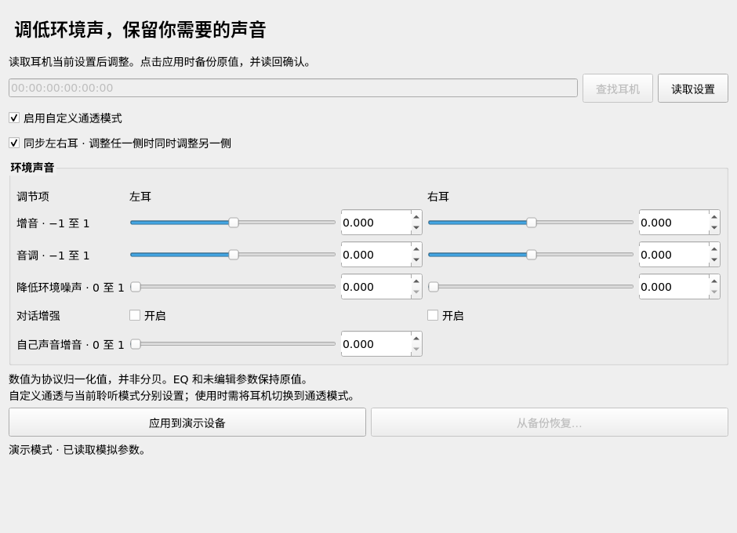

# AirPods Transparency for Linux

在 Linux 上读取和调节 AirPods **自定义通透模式**，不必连接 iPhone 或 Mac。

提供中文 Qt 桌面界面和零第三方依赖的命令行。基于 LibrePods 已公开的协议重新实现，
只操作通透参数 `0x0018`，不操作助听器参数 `0x002A`、听力图或固件。
默认优先通过 BlueZ 的 D-Bus GATT 接口读写，未发现服务时才使用直接 ATT 连接。
命令行依赖系统的 `busctl`（systemd）和 `bluetoothctl`（BlueZ）。

**状态：已在一副 AirPods Pro 3 上完成实机读取、备份、写入和读回验证。**
Ubuntu 22.04 配置 Apple DeviceID、重启蓝牙并重新连接耳机后，原来的 `ATT 0x0e`
错误消失。已成功启用自定义通透，并把左右耳增音从 0 改为 −0.2；其余参数保持原值。
关闭参数连接后，新连接再次读取也确认了修改。听感效果、蓝牙重连后的保持情况和其他固件
仍需验证。具体记录见 [实机验证](docs/hardware-validation.md)。



## 安装与运行

需要 Linux、Python 3.10+、BlueZ 和已配对并连接的 AirPods。

```sh
python3 -m venv .venv
.venv/bin/pip install '.[gui]'
.venv/bin/airpods-transparency devices
.venv/bin/airpods-transparency gui
```

Ubuntu 如果缺少 venv：先安装 `python3-venv`。仅使用命令行可将 `'.[gui]'` 改为 `.`。
无需安装即可运行命令行：`python3 -m airpods_transparency --help`。
精简系统上 Qt 界面可能还需要系统运行库：`sudo apt install libegl1 libxcb-cursor0`。

界面：输入或查找耳机地址 → 读取设置 → 调整 → 备份并应用。
“启用自定义通透模式”控制自定义参数是否启用；耳机当前聆听模式仍需切换到**通透**，
可以使用耳柄的长按操作。工具暂不切换降噪/通透模式，也不负责蓝牙配对。

演示模式不访问真实设备：

```sh
.venv/bin/airpods-transparency gui --demo
```

指定 `gui --mac AA:BB:CC:DD:EE:FF` 时，界面自动读取参数。

## 先诊断访问权限

下列 `AA:BB:CC:DD:EE:FF` 都应替换为 `devices` 命令显示的耳机地址。

```sh
python3 -m airpods_transparency doctor --mac AA:BB:CC:DD:EE:FF
python3 -m airpods_transparency read --mac AA:BB:CC:DD:EE:FF
```

`doctor` 只读检查配对、连接、配置文件和通透数据，不会写耳机参数。
如遇 `0x0e`、授权或认证错误，按以下步骤检查 Apple DeviceID。
连接被拒绝或超时也可能是耳机未连接、其他控制程序占用通道，或固件不兼容。
系统 BlueZ 完成 GATT 服务发现后会占用 ATT 通道，此时直接 ATT 连接可返回
`Connection refused`，即使音频仍正常。本工具会按设备地址和特征 UUID
`d5621cc1-f7ab-45db-9403-9eaf744d5390` 找到服务，使用 BlueZ 已有的连接，
不要求重启蓝牙。按特征属性选择有响应/无响应写入，随后仍读回完整参数核对。

### JSON 调试入口

GUI 与 CLI 共用控制器及传输层。成功、运行错误及参数错误均可输出 JSON，失败退出码为 1：

```sh
python3 -m airpods_transparency doctor --mac AA:BB:CC:DD:EE:FF --json
python3 -m airpods_transparency read --mac AA:BB:CC:DD:EE:FF --json
python3 -m airpods_transparency --json devices
```

JSON 包含 `ok`、实际使用的 `backend`（成功读取时）、参数或结构化 `error`（类型、
消息、系统 errno、ATT 错误码）；`doctor` 失败时还保留已完成的连接/配置诊断。
所有带 `--mac` 的 CLI 操作支持 `--transport auto|bluez|att`，便于分别诊断两条路径。
`--transport att` 在 BlueZ 已接管 ATT 时失败是预期结果；通常应保留默认 `auto`。

## Apple DeviceID：一次性系统配置

LibrePods 文档说明，部分参数要求主机使用苹果的蓝牙 DeviceID。此配置适用于整个电脑
的蓝牙服务，重启会暂时断开蓝牙键盘、鼠标及耳机。

可以使用仓库提供的可回退配置工具。它在改动前保存 `/etc/bluetooth/main.conf` 原文件，
只编辑 `[General]` 下的 DeviceID，不自动重启服务、不移除任何配对。

```sh
sudo python3 tools/configure_bluez.py --enable
sudo systemctl restart bluetooth
```

或手动在 `/etc/bluetooth/main.conf` 的 `[General]` 节设置：

```ini
DeviceID = bluetooth:004C:0000:0000
```

重新连接耳机后再运行 `doctor`。耳机可能缓存主机身份，必要时在系统蓝牙设置中移除
**这一副耳机**再配对。若已连到耳机但仍返回错误，请保留错误信息；不要尝试随机句柄。

配置工具会打印备份路径。恢复主机原配置：

```sh
sudo python3 tools/configure_bluez.py --restore /etc/bluetooth/main.conf.airpods-BACKUP
sudo systemctl restart bluetooth
```

上面的备份路径是占位符，请使用工具实际输出。LibrePods 提醒，模拟苹果身份可能导致
部分固件周期性断开连接；遇到这种情况应恢复原配置。

## 命令行调节

先 `read` 查看实际值。以下是语法示例，不代表经听感验证的推荐参数：

```sh
python3 -m airpods_transparency set --mac AA:BB:CC:DD:EE:FF \
  --enabled on --amplification -0.2 --noise-reduction 0.3 --conversation-boost off
```

同一参数可以分别设置左右耳，单耳参数优先于公共参数：

```sh
python3 -m airpods_transparency set --mac AA:BB:CC:DD:EE:FF \
  --left-amplification -0.1 --right-amplification -0.2
```

支持：`--enabled on|off`、`--amplification -1..1`、`--tone -1..1`、
`--noise-reduction 0..1`、`--conversation-boost on|off`、`--own-voice 0..1`。
中间四项均支持 `--left-…` 和 `--right-…`。
这些数值是协议中的归一化值，**不是分贝**；没有承诺与苹果界面刻度完全一致。
100 字节布局没有 `own-voice` 字段，会拒绝设置它。

每次实际写入之前都会将完整原始值保存到
`${XDG_STATE_HOME:-~/.local/state}/airpods-transparency/backups/`，文件权限为 `0600`。
不变的设置不会触发写入；没有指定修改的 EQ、另一只耳朵及其他参数均逐字节保留。
写入后必须读回完全一致才报告成功。失败时会显示备份路径；此时耳机状态可能已改变，
请重新读取后再操作，工具不会反复自动写入。

```sh
python3 -m airpods_transparency backup --mac AA:BB:CC:DD:EE:FF
python3 -m airpods_transparency restore --mac AA:BB:CC:DD:EE:FF /path/to/backup.json
```

恢复也会先备份当前值。备份绑定耳机蓝牙地址，拒绝恢复到另一副耳机或不同长度的布局。

## 协议与来源

依据 LibrePods 提交 `89356c08cea3db0b6b54792d9329d09a87cc85fa`：

- [Transparency.kt](https://github.com/librepods-org/librepods/blob/89356c08cea3db0b6b54792d9329d09a87cc85fa/android/app/src/main/java/me/kavishdevar/librepods/data/Transparency.kt)：100/104 字节、little-endian float 参数布局。
- [ATTManager.kt](https://github.com/librepods-org/librepods/blob/89356c08cea3db0b6b54792d9329d09a87cc85fa/android/app/src/main/java/me/kavishdevar/librepods/bluetooth/ATTManager.kt)：通透句柄 `0x18` 与 ATT 读写。
- [Linux 文档](https://github.com/librepods-org/librepods/blob/89356c08cea3db0b6b54792d9329d09a87cc85fa/linux/README.md)：BR/EDR ATT 接入及 DeviceID 配置。

传输使用 Bluetooth L2CAP PSM `0x001f`（ATT），与切换降噪模式使用的 AACP 通道不同。
现有旧版 `hearing-aid-adjustments.py` 实际写入助听句柄，**没有直接把它当成通透工具复制**。
本项目按通透源码实现，采用 GPL-3.0-or-later，向 LibrePods 及协议研究贡献者致谢。

直接 ATT 路径使用上游公布的 `0x18` 句柄；BlueZ 路径按 UUID 发现特征，
不依赖系统生成的对象路径编号。两条路径均支持 100/104 字节布局。
检测长度、有限浮点数及字段范围，未知布局拒绝写入。没有固件白名单；
结构检查不能证明所有固件语义相同。
这是读写协议验证工具，尚不保证参数在切换设备、重连或重启耳机后如何保持。

## 开发与验证

```sh
python3 -m pip install -e '.[test,gui]'
pytest -q
QT_QPA_PLATFORM=offscreen python3 -m pytest tests/gui_smoke.py -q
```

CI 测试参数完整性、异常响应、通知与响应分离、备份先于写入、恢复、并发修改检测、写后
验证失败等路径。GUI 冒烟测试使用模拟设备；真实耳机的授权、读写及听感需另行验证。

不需要 Apple 账户、云服务或固件提取。应用没有遥测，也不上传耳机参数。
