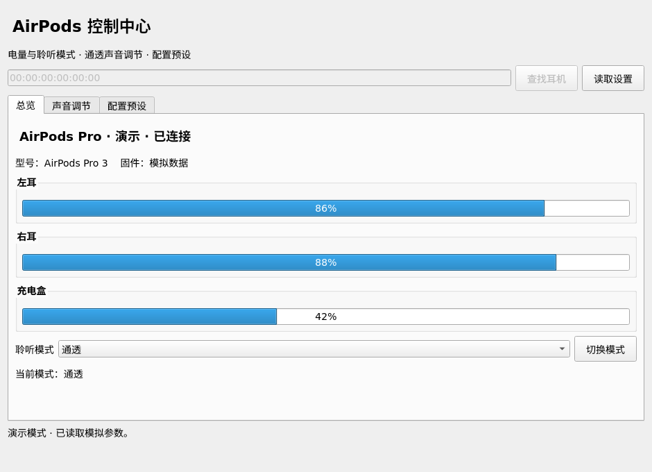

# AirPods Control for Linux

在 Linux 上查看 AirPods 电量、切换降噪模式，以及调节通透模式的环境声音。提供桌面界面、系统托盘和命令行，无需 Apple 账户。



## 功能

- 查看左右耳、充电盒的电量和充电状态，以及设备型号、固件信息。
- 切换降噪、通透、自适应和关闭模式。
- 调节通透模式的增音、音调、环境降噪、对话增强和自己声音增音，支持左右耳同步调节。
- 保存声音配置为预设，一键应用；修改前自动备份原值。
- 从系统托盘查看状态、切换模式和应用预设；通过 CLI / JSON 接入脚本。

目前主要在 **Ubuntu 22.04 + AirPods Pro 3** 上验证。其他型号和固件的功能支持可能不同；充电盒未报告电量时，界面会显示“未报告”。

## 安装

需要 Python 3.10+、BlueZ，以及 systemd 提供的 `busctl`。耳机需先通过系统蓝牙设置配对并连接。

Ubuntu / Debian 可先安装依赖：

```bash
sudo apt update
sudo apt install git python3-venv bluez libegl1 libxcb-cursor0
```

下载并安装应用：

```bash
git clone https://github.com/Taardisaa/airpods-transparency-linux.git
cd airpods-transparency-linux
python3 -m venv .venv
source .venv/bin/activate
pip install '.[gui]'
```

后续命令均在仓库目录、已激活的虚拟环境中运行。只使用命令行时，可将 `'.[gui]'` 换成 `.`。

将应用图标加入当前用户的应用菜单：

```bash
python tools/install_desktop.py
```

随后可在应用菜单搜索 **AirPods Control** 或 **AirPods 控制中心**。启动项使用当前虚拟环境，请保留仓库及 `.venv` 目录。

## 首次配置

### 启用自定义通透调节

部分 AirPods 设置要求电脑报告苹果的蓝牙 DeviceID。使用声音调节前，建议完成这项一次性配置：

```bash
sudo python3 tools/configure_bluez.py --enable
sudo systemctl restart bluetooth
```

配置工具会先备份 `/etc/bluetooth/main.conf`，并打印备份路径。重启蓝牙会短暂断开蓝牙耳机、键盘和鼠标；完成后重新连接 AirPods。

如果配置后仍遇到授权错误，可在系统蓝牙设置中移除这一副耳机，再重新配对。需要恢复电脑原配置时，使用工具打印的实际备份路径：

```bash
sudo python3 tools/configure_bluez.py --restore /path/to/main.conf.backup
sudo systemctl restart bluetooth
```

### 打开控制中心

```bash
airpods-control devices
airpods-control gui
```

在窗口中点击“查找耳机”，选择设备并“读取设置”。也可以把 `devices` 列出的耳机地址传给启动命令，自动读取：

```bash
airpods-control gui --mac AA:BB:CC:DD:EE:FF
```

文档中的 `AA:BB:CC:DD:EE:FF` 都是占位符，请替换为自己的耳机地址。应用日常运行不需要 `sudo`。

## 使用

**总览**显示电量、设备信息和当前聆听模式。选择模式后点击“切换模式”；收到耳机确认后才会显示切换成功。

**声音调节**提供滑条和精确输入框。“同步左右耳”默认开启，调整一侧会同时调整另一侧。编辑完成后点击“备份并应用”写入耳机；只拖动滑条不会立即生效。要试听自定义通透设置，还需在总览中将聆听模式切到“通透”。

**配置预设**用于保存耳机当前已经应用的设置，可以选择是否包含聆听模式。先应用声音调整，再保存预设；以后选择预设即可恢复这组配置。同名保存会覆盖原预设。

系统支持托盘时，关闭窗口会收起到托盘，右键图标可切换模式、应用预设或退出界面。使用 `airpods-control gui --tray` 可直接从托盘启动；没有托盘支持时，应用仍会显示正常窗口。

## 通透参数

这些参数控制的是听到的**环境声音**，不是音乐播放音量。数值为归一化值，**不是分贝**。

| 参数 | 范围 | 作用 |
| --- | --- | --- |
| 自定义通透开关 | 开 / 关 | 启用或停用自定义声音参数，与降噪 / 通透模式选择分别控制 |
| 增音 | −1～1 | 调整环境声的放大程度；觉得周围声音太响时，可尝试调低 |
| 音调 | −1～1 | 调整环境声的音色 |
| 降低环境噪声 | 0～1 | 调整对背景噪声的抑制程度 |
| 对话增强 | 开 / 关 | 突出面对面交谈的人声 |
| 自己声音增音 | 0～1 | 调整自己说话声音的放大程度，需设备支持 |

增音、音调、降低环境噪声和对话增强均可分别调节左右耳。关闭左右耳同步后即可单独调整。

每次实际修改声音参数前都会保存原值，并在写入后读回核对。需要撤销时，点击“从备份恢复”，选择对应备份。备份默认位于 `~/.local/state/airpods-transparency/backups/`，只能恢复到原来的耳机。

## 命令行

GUI 和命令行使用同一个后台服务。常用命令：

```bash
# 查看电量和当前模式
airpods-control status --mac AA:BB:CC:DD:EE:FF --json

# 切换到降噪模式
airpods-control mode anc --mac AA:BB:CC:DD:EE:FF --json

# 保存当前配置
airpods-control preset save "Office" --mac AA:BB:CC:DD:EE:FF --json
```

完整命令、参数调节和 JSON 示例见 [命令行参考](docs/cli.md)。原命令名 `airpods-transparency` 仍可使用。

## 常见问题

**耳机连着，但读取或应用失败？**

先运行诊断，检查连接状态与 DeviceID 配置：

```bash
airpods-control doctor --mac AA:BB:CC:DD:EE:FF --json
```

保留默认的自动连接方式即可。仍然失败时，可重新连接耳机，并检查 `~/.local/state/airpods-transparency/service.log`。

**修改了参数，为什么声音没变化？**

确认已开启“自定义通透模式”、点击“备份并应用”，并将当前聆听模式切换到“通透”。部分参数的效果也取决于耳机型号和固件。

**升级后还是旧版本？**

退出托盘中的界面，再更新代码并重启后台服务：

```bash
git pull
pip install '.[gui]'
airpods-control service stop --json
airpods-control gui
```

后台服务会在下次使用时自动启动；退出窗口不影响命令行继续使用。

## 许可与致谢

采用 [GPL-3.0-or-later](LICENSE) 许可。协议实现参考 [LibrePods](https://github.com/librepods-org/librepods)，感谢其协议研究贡献者。来源说明见 [第三方声明](THIRD_PARTY_NOTICES.md)。

参与开发请参阅 [开发说明](docs/development.md)；设备测试范围见 [实机验证记录](docs/hardware-validation.md)。
